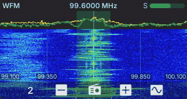
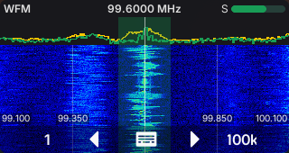
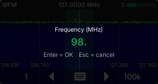
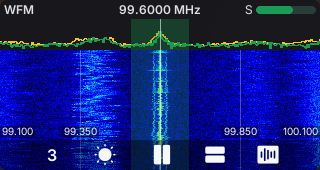

# SDR — a live SDR receiver for the M5Stack CardputerZero (`apps/sdr`)

The **SDR** app is part of **ZeroRadio 1.0.0**. It turns the
[M5Stack CardputerZero](https://shop.m5stack.com/pages/m5-cardputerzero) (a Linux ARM64 handheld with a 320×170 RGB565
display and a physical keyboard) into a pocket **software-defined-radio terminal**. It draws a live
FFT **spectrum** and a scrolling **waterfall**, and plays **demodulated audio** from an RTL-SDR dongle.

It is a graphical [LVGL](https://lvgl.io/) application built on the shared **`radio_toolkit`** (the
reactive MVVM shell and widgets). Development runs on a desktop **SDL simulator** at the device
resolution (320×170).



> The desktop SDL simulator at the native device resolution (320×170), driven by a real
> RTL-SDR Blog V4 — a live WFM broadcast around 99.6 MHz.

## Features

- **Live spectrum + waterfall** — a 320-bin FFT line chart over a scrolling RGB565 waterfall
  (black→blue→cyan→yellow→red colormap), full-width, ~30 fps.
- **RTL-SDR source** — the app starts its own `rtl_tcp` for the dongle in the USB-A port and stops it
  on exit. `RtlTcpSource` reads raw IQ on a background thread and runs an FFT (FFTW, single
  precision) with an adaptive noise floor. Tuning and zoom **retune the hardware** and crop the FFT window.
- **Audio demodulation** — `AudioDemod` reads the same IQ stream and outputs 48 kHz mono through SDL
  on the desktop or **ALSA on the device**. Modes: **WFM**, **NFM** (narrow FM), **AM** (envelope + AGC),
  **USB/LSB** (Weaver), **CW**.
- **7-page toolbar** — the 5 physical keys (`4`–`8`) drive tuning, zoom/band, visual options,
  **audio** (mute / volume), **squelch**, **settings** (gain / exit) and **calibration** (frequency
  correction in ppm). No pointer is needed.
- **Squelch** — mutes the audio until the signal in the passband reaches a level (5–95 on the
  S-meter scale). It closes 8 points below the level after a 2.5 s hold, so pauses in speech pass.
  `Squelch` and `channel_level()` in `src/sdr/squelch.h` are pure and tested by `squelch_test`.
- **Channel S-meter** — the S-meter shows the strongest bin inside the demodulated passband, not the
  whole span, so a strong station next door does not move it.
- **Frequency correction** — the dongle's crystal error in tenths of ppm, in the `rtl_test -p` sign
  convention. The app asks the tuner for the VFO divided by (1 + ppm), so a known station lands on the
  centre line at every frequency. librtlsdr only takes whole ppm, so the correction stays in the app
  and `rtl_tcp` keeps 0 ppm.
- **Passband overlay, peak hold, reference grids** — a highlight of the demodulated bandwidth per
  mode, a decaying peak trace, an EMA-smoothed spectrum line and a vertical frequency grid.
- **Adjustable waterfall/spectrum split** — key `7` on the Visual page cycles the layout presets
  (waterfall 80 / 50 / 0 / 100 % of the plot area).
- **Manual frequency entry** — a modal keypad dialog that captures keys directly through the
  toolkit's `platform::set_key_capture`.
- **Session persistence** — the app restores VFO, mode, zoom, band, volume/mute, squelch, gain,
  frequency correction, theme and grids on the next launch (`~/.config/zeroradio/sdr/state`).
- **Mock source** — `SDR_SOURCE=mock` runs a synthetic source with no dongle, for UI work.

## How it works

**The signal path.** The RTL-SDR dongle sits in the CardputerZero USB-A port. On start, the app
launches `rtl_tcp` on `127.0.0.1:1234`, which streams raw 8-bit IQ samples over TCP. A background
thread uses the same sample stream twice, so the UI never blocks:

1. **For the display** — it runs an FFT (FFTW) over the IQ, converts the result to dB, tracks an
   adaptive noise floor and normalizes to 0–1. Each frame becomes one new waterfall line and one
   spectrum trace.
2. **For the audio** — a demodulator decimates to 48 kHz and applies the algorithm for the selected
   mode (FM discriminator for WFM/NFM, envelope for AM, Weaver for SSB/CW). The system audio plays it.

**What you see.** The header shows the demod **mode** on the left, the tuned **frequency** centred
over a marker line, and an **S-meter** on the right. The **spectrum** chart sits below it, and the
**waterfall** fills the rest of the screen. A translucent green band marks the **passband**.

**How you drive it.** Keys `4`–`8` map to a bottom toolbar. Key `4` cycles seven tool pages (Tuning,
Zoom/Band, Visual, Audio, Squelch, Settings, Calibration), and the other four keys act on the current page. Tuning or
zooming retunes the dongle in real time, so the waterfall and the audio follow at once.

## Screenshots

| Spectrum + waterfall | Frequency entry | Visual controls |
| --- | --- | --- |
|  |  |  |

All captured live from an RTL-SDR Blog V4 (WFM broadcast, ~99.6 MHz) at native 320×170.

## On the CardputerZero

The dongle plugs into the CardputerZero USB-A port (V0.6 hardware). The RTL-SDR Blog V4 works with
Debian's `rtl-sdr` 2.0.2, which the `.deb` pulls in. Open **SDR** from the ZeroRadio hub. The app
starts `rtl_tcp` itself and stops it when you quit.

Demodulated audio plays out of the device speaker through ALSA. The image is PipeWire-managed, so
the default sink is the `pipewire` PCM (see
[`docs/sdr-device-profile.md`](../../docs/sdr-device-profile.md)). The hub's launch wrapper sets
`SDR_SAMPLE_RATE=1024000` and `SDR_ALSA_DEV=pipewire`.

To use a dongle on another machine, run `rtl_tcp -a 0.0.0.0 -p 1234` there and start the app with
`SDR_RTLTCP=<host>:1234`. The app then connects to that server and starts no local one.

## Quick start (desktop, with a real RTL-SDR)

```shell
# 1. Dependencies (Arch shown). The RTL-SDR Blog V4 needs rtl-sdr >= 2.0.
sudo pacman -S --needed cmake ninja sdl2 fmt libpng libjpeg-turbo freetype2 zlib fftw rtl-sdr

# 2. Build the monorepo simulator (from the repo root)
cmake --preset linux-x86-64
cmake --build --preset linux-x86-64-dbg

# 3. Plug the dongle and run: the app starts rtl_tcp itself
./build/linux-x86-64/apps/sdr/Debug/sdr_app
```

Tune to a strong **WFM broadcast** station (page 2 → band preset, or page 1 → frequency entry). Set
the mode to **WFM** on page 2. The waterfall shows a strong carrier and the speaker plays the audio.

Environment overrides:

| Variable | Effect |
| --- | --- |
| `SDR_SOURCE=mock` | Use the synthetic source instead of the dongle. |
| `SDR_RTLTCP=host:port` | Connect to an existing `rtl_tcp` server instead of starting a local one. |
| `SDR_FREQ=<hz>` | Start tuned to this frequency, overriding the saved VFO. The Scanner's **Open in SDR** uses it. |
| `SDR_MODE=<mode>` | Start in this mode, overriding the saved one: `WFM`, `NFM`, `AM`, `USB`, `LSB` or `CW`. An unknown name keeps the saved mode. The Memories app passes it with `SDR_FREQ`. The SDR reads both once at start and then clears them, so a later TAB switch keeps your tuning. |
| `SDR_SAMPLE_RATE=<hz>` | Cap the RTL sample rate (valid: 900k–3.2M or 225k–300k). The CM0 needs ~1.0 Msps. Below the cap, the rate follows the page-2 zoom span. |
| `SDR_ALSA_DEV`, `SDR_ALSA_CARD` | ALSA output PCM / card on the device (default `pipewire`). |

## Controls

The bottom NavBar maps the five physical keys `4`–`8` to five slots. The **leftmost key (`4`)
cycles the tool page** (1→7) and shows the page name.

| Key | P1 · Tuning | P2 · Zoom/Band | P3 · Visual | P4 · Audio | P5 · Squelch | P6 · Settings | P7 · Calibration |
| --- | --- | --- | --- | --- | --- | --- | --- |
| `4` | page switch | page switch | page switch | page switch | page switch | page switch | page switch |
| `5` | tune − | zoom − | dark/light | mute | level −5 | gain − | correction −0.1 ppm |
| `6` | **frequency entry** | band preset | freq grid | volume − | **on/off** | gain + | **correction entry** (ppm) |
| `7` | tune + | zoom + | **waterfall/spectrum split** (80/50/0/100 %) | volume + | level +5 | gain auto / value | correction +0.1 ppm |
| `8` | coarse/fine (step) | **demod mode** | peak hold | volume % | level | exit | correction (ppm) |

Global keys, shared by every ZeroRadio app:

- `Esc` — back to the hub. Hold `Esc` 3 s to return to the system launcher (let go earlier to cancel). `SYM` + `4`–`8` shows what each key does.
- `H` — open the in-app help ([`docs/help/sdr.md`](../../docs/help/sdr.md)).
- `TAB` — switch to the Scanner app.

## Architecture

Reactive MVVM with a one-way data flow. The UI observes LVGL *subjects* and never reads state
directly. The shared `radio_toolkit` provides the shell (key routing, NavBar, BaseScreen, reactive
bindings, theme, assets, run loop). Only the SDR-specific pieces live in this app.

```
input (keys 4-8 + ESC) → key router (toolkit platform/linux_input)
   ├─ 4..8  → NavBar slot → NavProvider::nav_activate(page,slot) → SdrViewModel action → SdrModel + publish subject
   ├─ ESC   → quit handler (toolkit run_app)
   └─ capture → while the frequency dialog is open, every key goes to it

live data (independent of input):
   RTL-SDR ──rtl_tcp(TCP IQ)──▶ RtlTcpSource (reader thread)
                                   ├─ FFT (FFTW) ─▶ shared magnitudes ─▶ next_frame() ─▶ chart + waterfall
                                   └─ AudioDemod  ─▶ demod per mode ─▶ SDL (desktop) / ALSA (device) audio (48 kHz)
   lv_timer (~33 ms) → SpectrumScreen::tick(): set_tuning/mode/volume/gain, pull a frame, draw
```

SDR-specific files (`apps/sdr/src/`):

- **`sdr/spectrum_source.{h,cpp}`** — the `SpectrumSource` interface the UI depends on
  (`next_frame`, `set_tuning`, `set_mode`, `set_volume/muted`, `set_gain`) plus `MockSpectrumSource`.
- **`sdr/rtl_tcp_source.{h,cpp}`** — the real source: it starts the local `rtl_tcp`
  (`spawn_local_server`), runs the client and the FFTW spectrum, and retunes the hardware with a
  zoom-following sample rate. Gated by `SDR_HAVE_RTLTCP`.
- **`sdr/audio_demod.{h,cpp}`** — the multi-mode demodulator (decimating FIRs, FM discriminator, AM
  envelope, Weaver SSB/CW, AGC) with SDL (desktop) or ALSA (device) output.
- **`view/spectrum_screen.{h,cpp}`** — the SDR screen: header, chart, waterfall, passband, grids and
  frequency dialog, on the toolkit's `BaseScreen`.
- **`model/sdr_model.{h,cpp}` / `viewmodel/sdr_viewmodel.{h,cpp}`** — radio state (VFO in Hz, mode,
  span, bands, audio, gain, persistence) and the reactive subjects/actions, on the toolkit's
  `ShellViewModel` + `NavProvider`.

## Build

CMake ≥ 3.31, C++17. The build links **FFTW3 (single precision)** and **threads** for the real
source. CMake sets `SDR_HAVE_RTLTCP` when it finds `fftw3f`. Without FFTW the app runs on the mock.

```shell
cmake --preset linux-x86-64
cmake --build --preset linux-x86-64-dbg   # → build/linux-x86-64/apps/sdr/Debug/sdr_app
# release: cmake --build --preset linux-x86-64-rel
```

> **Editor note:** clang in the editor may report false positives (`lvgl.h not found`, `lv_subject_t
> unknown`) because it does not see CMake's include paths. `cmake --build` is the source of truth.

Device builds run in a Debian trixie container (preset `cp0-trixie`), which adds ALSA audio:

```shell
scripts/cp0-docker-build.sh --target sdr_app   # one app
scripts/cp0-docker-build.sh --package          # the whole suite + the zeroradio .deb
```

The `.deb` installs every app under `/usr/share/zeroradio`.

## Known limitations

- WFM is verified by ear. NFM, AM, SSB and CW audio still need a check with a proper antenna in a
  quieter RF environment.
- The frequency correction moves the tuned centre only. The crystal error also scales the sample
  rate, so the span edges and the audio pitch keep the error: half a hertz per ppm at the edge of a
  1 MHz span, which is too small to see.
- Waterfall frequency labels show 3 decimals (1 kHz resolution). The header shows 4 decimals, so
  100 Hz fine tuning appears on the header but not on the waterfall scale.

## Roadmap

- Verify FM/AM/SSB/CW audio with a proper antenna.
- Settings page: sample rate and bias-tee (gain and ppm correction are done).
- HackRF front-end via SoapySDR (RTL-SDR v3/v4 and compatible dongles work today).

## License

MIT. See the repo `assets/` folder for third-party asset license notes.
