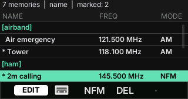

# ZeroRadio user manual

This manual is for ZeroRadio 1.2.0 on the [M5Stack CardputerZero](https://shop.m5stack.com/pages/m5-cardputerzero). It lists every key, including the ones you hold and the key combinations. The bottom bar shows only part of them.

Inside any app, press **H** to open the help of that app. Press **SYM + 4 to 8** to see what one key does on the current page.

## Contents

- [What you need](#what-you-need)
- [Start](#start)
- [How the keys work](#how-the-keys-work)
- [Keys you hold, and key combinations](#keys-you-hold-and-key-combinations)
- [SDR](#sdr)
- [Scanner](#scanner)
- [Memories](#memories)
- [ISM](#ism)
- [ADS-B and AIS](#ads-b-and-ais)
- [How to](#how-to)
- [Saved settings](#saved-settings)

## What you need

- An RTL-SDR dongle in the USB-A port, for example the RTL-SDR Blog V4.
- An antenna for the band you listen to. The small telescopic antenna works for FM broadcast. Aircraft (1090 MHz) and ships (162 MHz) need a better antenna, placed high.

Every app starts its own decoder and stops it when you leave, so only one app uses the dongle at a time. The dongle drains the battery fast. Leave the app when you stop listening.

## Start

Open **ZeroRadio** from the launcher. The menu lists the apps:

- F/X (up/down), or 5 and 7, move the selection.
- Enter, C (right) or 6 opens the app.
- Esc leaves ZeroRadio.

The menu starts on the app you used last. The last row, **About**, shows the version, a QR code to this page, the changelog and the credits.

## How the keys work

The bottom bar has five keys, which match the number keys **4 5 6 7 8** of the keyboard.

- **Key 4** shows the name of the current page of keys, such as TUNE or LIST. Press it for the next page. Hold it for the page before.
- **Keys 5, 6, 7 and 8** do what the bar shows above them. Each page gives them other actions.
- A greyed key does nothing on this page, for example "open" when the list is empty.

The arrow keys are the letters with arrows printed on them:

| Key | Arrow |
| --- | --- |
| F | Up |
| X | Down |
| Z | Left |
| C | Right |

Some dialogs (frequency entry, Location) use Fn + the arrow keys, because F, X, Z and C type letters there.

## Keys you hold, and key combinations

| Key | Where | What it does |
| --- | --- | --- |
| Hold 4 | Every app | The page of keys before the current one |
| Hold Esc 3 s | Every app | Leave ZeroRadio for the CardputerZero launcher. A toast shows while you hold. Let go earlier to cancel |
| Hold Z or C | Every app | Repeat left/right: after 0.4 s, ten times a second. The SDR keeps tuning |
| Hold 5 or 7 | SDR, TUNE page | Keep tuning down or up |
| **M** | SDR, Scanner | Save a memory: the tuned frequency in the SDR, the selected peak in the Scanner |
| Hold 6 | SDR TUNE page, Scanner SWEEP page | Save a memory, like M. A short press still opens the frequency entry |
| Press 7 twice | Memories, EDIT page | Delete the selected memory. The first press shows DEL?, the second deletes. DEL? goes away by itself after 4 s |
| Hold 8 | ADS-B and AIS map | Follow the selected aircraft or ship. Hold again to stop |
| Enter | Scanner, PEAKS page | Open the selected peak in the SDR |
| Enter | Memories | Open the selected memory in the SDR |
| Enter | ADS-B and AIS map | Centre the map on your position again |
| TAB | SDR, Scanner | Switch between the SDR and the Scanner |
| TAB | Memories | Sort each group by name or by frequency |
| SYM + 4 to 8 | Every app | What that key does on this page, in the system language |
| SYM + . | Frequency entry | The decimal point, for example 98.525 |
| Fn + A | SDR | Mute or unmute, from any page |
| Fn + S, Fn + D | SDR | Volume down, volume up, from any page |
| H or Fn + H | Every app | The help of this app. F/X scroll it, Esc closes it |

The tooltips of SYM + 4 to 8 come in English, Italian, French, German, Spanish, Japanese and Chinese. They follow the system language. Other languages show English.

## SDR

The SDR shows the spectrum and the waterfall around the tuned frequency, and plays the audio on the speaker. It demodulates WFM (broadcast FM), NFM, AM, USB, LSB and CW.

At the top of the screen:

- the mode is on the left;
- the tuned frequency is in the middle;
- the S-meter is on the right.

Under them are the spectrum and the waterfall. The green band is the passband you hear, and the S-meter measures the signal inside it.

### Pages

| Page (key 4) | 5 | 6 | 7 | 8 |
| --- | --- | --- | --- | --- |
| TUNE | Tune down | Frequency entry (hold: save a memory) | Tune up | Coarse/fine step |
| ZOOM | Zoom out | Next band: FM, Air, 2m, 70cm | Zoom in | Next mode |
| VIEW | Dark/light theme | Frequency grid | Waterfall/spectrum split | Peak hold |
| AUDIO | Mute | Volume down | Volume up | Shows the volume |
| SQL | Squelch level down | Squelch on/off | Squelch level up | Shows the level |
| GAIN | Gain down | Gain up | Auto gain on/off | CAL: calibrate the frequency |
| CAL (after 8 on GAIN) | Correction down 0.1 ppm | Correction entry | Correction up 0.1 ppm | OK: done |
| SCAN (during a memory scan) | Pause or resume | Skip to the next channel | Lock out this channel | Stop and stay here |

The arrows: Z/C tune down/up by one step, F/X zoom in/out.

**Frequency entry** (TUNE, key 6). Type the frequency in MHz, with up to 4 decimals. SYM + . types the dot. Backspace deletes, Enter tunes, Esc cancels.

**Step.** Key 8 on TUNE switches between a coarse and a fine step, and the key shows the step. The step depends on the mode:

| Mode | Coarse | Fine |
| --- | --- | --- |
| WFM | 100 kHz | 10 kHz |
| NFM | 25 kHz | 5 kHz |
| AM | 9 kHz | 1 kHz |
| USB, LSB | 1 kHz | 100 Hz |
| CW | 500 Hz | 100 Hz |

**Zoom.** The span goes from 2 MHz to 100 kHz: 2 MHz, 1.5 MHz, 1 MHz, 500 kHz, 200 kHz, 100 kHz. A new install starts at 1 MHz. A narrower zoom lowers the CPU load.

**Squelch** (SQL page). The squelch keeps the speaker quiet until a signal comes in. A white tick on the S-meter marks its level. The audio opens when the S-meter reaches the tick. It closes 2.5 s after the signal drops, so a short pause in speech does not cut it. Keys 5 and 7 move the level by 5, and they also turn the squelch on. To set it, tune to a quiet channel, then raise the level until the noise stops.

**Calibration** (GAIN, key 8). See [Calibrate the frequency](#calibrate-the-frequency).

### SDR: keys not on the bar

| Key | What it does |
| --- | --- |
| Z / C | Tune down / up by one step. Hold to keep tuning |
| Hold 5 or 7 on TUNE | Keep tuning down or up |
| F / X | Zoom in / out |
| M | Save the tuned frequency and mode as a memory |
| Hold 6 on TUNE | Save a memory, like M. A short press opens the frequency entry |
| Fn + A | Mute or unmute, from any page |
| Fn + S / Fn + D | Volume down / up, from any page |
| TAB | Switch to the Scanner |
| SYM + . | The decimal point in the frequency entry |
| - | Change the sign in the correction entry (CAL, key 6) |
| Moving to another page | Ends the calibration and puts the zoom back |

Every app also has hold 4 (page before), SYM + 4 to 8 (what a key does), H (help), Esc (back to the menu) and hold Esc 3 s (leave ZeroRadio).

## Scanner

The Scanner sweeps a wide band, for example the whole FM broadcast band, and lists the strongest signals (peaks). Open a peak in the SDR to listen.

| Page (key 4) | 5 | 6 | 7 | 8 |
| --- | --- | --- | --- | --- |
| SWEEP | Zoom out (wider) | Tune dialog (hold: save a memory) | Zoom in (narrower) | Dark/light theme |
| PEAKS | Cursor up | Cursor down | Open in the SDR | Next sort order |

- On SWEEP, F/X zoom and Z/C move the swept band by a quarter of its width.
- On PEAKS, F/X move the cursor and Enter opens the selected peak in the SDR.
- Sort (PEAKS, key 8): power, frequency or age, each descending, then ascending.

**Tune dialog** (SWEEP, key 6). Type the centre in MHz and press Enter. Then type the total width in MHz and press Enter. F/X move between the two fields. Esc cancels.

### Scanner: keys not on the bar

| Key | What it does |
| --- | --- |
| F / X on SWEEP | Zoom in / out |
| Z / C on SWEEP | Move the swept band down / up by a quarter of its width. Hold to keep moving |
| F / X on PEAKS | Move the cursor |
| Enter on PEAKS | Open the selected peak in the SDR |
| M | Save the selected peak as a memory (the strongest one if you did not pick one) |
| Hold 6 on SWEEP | Save a memory, like M. A short press opens the tune dialog |
| TAB | Switch to the SDR |
| SYM + . | The decimal point in the tune dialog |

Every app also has hold 4 (page before), SYM + 4 to 8 (what a key does), H (help), Esc (back to the menu) and hold Esc 3 s (leave ZeroRadio).

## Memories

Memories lists your saved frequencies, grouped by their group (the first tag). It opens one in the SDR with its mode, scans a group, and edits the list.

| Page (key 4) | 5 | 6 | 7 | 8 |
| --- | --- | --- | --- | --- |
| MEM | Cursor up | Cursor down | Open in the SDR | Search the names |
| SCAN | Mark or unmark | Scan the marked memories, or the group | Scan the group | Clear the marks |
| EDIT | Rename or change the group | Next mode | Delete (press twice) | |

- F/X move the cursor. Enter opens the selected memory in the SDR.
- TAB sorts each group by name or by frequency.
- A `*` next to a name marks it for the scan.

**Search** (MEM, key 8). Type part of a name and press Enter. Clear the text and press Enter to show every memory again.

**Edit** (EDIT, key 5). The dialog shows the name and the group. Type to replace a field. Enter moves from the name to the group, then saves. Tab or Fn + F/X switch fields. Esc cancels.

**Mode** (EDIT, key 6). The mode steps through WFM, NFM, AM, USB, LSB and CW, and is saved at once.

**Delete** (EDIT, key 7). The key changes to DEL?. Press it again within 4 s to delete. Moving the cursor or changing the page cancels.

### Memories: keys not on the bar

| Key | What it does |
| --- | --- |
| F / X | Move the cursor. Group headings are skipped |
| Enter | Open the selected memory in the SDR, from any page |
| TAB | Sort each group by name or by frequency |
| 7, then 7 again within 4 s, on EDIT | Delete. DEL? goes away by itself, or when you move the cursor or change the page |
| Tab or Fn + F / X in the edit dialog | Switch between the name and the group. There F and X type letters |
| Enter in the scan confirmation | Start the scan in the SDR. Esc cancels |

Every app also has hold 4 (page before), SYM + 4 to 8 (what a key does), H (help), Esc (back to the menu) and hold Esc 3 s (leave ZeroRadio).

## ISM

ISM lists devices that transmit on 433.92 MHz: weather sensors, tyre-pressure sensors (TPMS), remotes and energy meters.

| Page (key 4) | 5 | 6 | 7 | 8 |
| --- | --- | --- | --- | --- |
| LIST | Next sort: model, age, signal | Previous device | Next device | Lock or unlock the device |
| DETAIL | Previous device | Next device | | Lock or unlock |
| SETUP | Previous row | Next row | Change the value | Quit |

Many sensors send every 30 to 60 s. Wait a minute before you decide nothing is there.

### ISM: keys not on the bar

| Key | What it does |
| --- | --- |
| F / X | Move the cursor on every page |
| Z / C on DETAIL | Previous / next device. Hold to keep stepping |
| Z / C in Settings | Change the value |

Every app also has hold 4 (page before), SYM + 4 to 8 (what a key does), H (help), Esc (back to the menu) and hold Esc 3 s (leave ZeroRadio).

## ADS-B and AIS

ADS-B shows aircraft around you from their 1090 MHz broadcasts. AIS shows ships from their broadcasts on 162 MHz. The two apps work the same way.

| Page (key 4) | 5 | 6 | 7 | 8 |
| --- | --- | --- | --- | --- |
| LIST | Next sort | Previous contact | Next contact | Lock or unlock the contact |
| RADAR / MAP | Zoom in | Zoom out (down to AUTO) | Trails on/off | Radar or map (hold: follow) |
| DETAIL | Zoom in | Zoom out | Trails on/off | Other traffic on/off |
| SETUP | Previous row | Next row | Change the value | Quit |

- F/X move the cursor in the list and in Settings. On the radar and the detail page they zoom.
- Z/C step through the contacts on the radar and the detail page, and change a value in Settings.
- On the map, the arrows move the centre and Enter centres it on your position again.
- On the map, hold 8 to follow the selected contact: an orange dot shows left of its name in the title. Hold 8 again, press an arrow or Enter to stop.

Zoom steps: 1, 2, 5, 10, 20, 50, 100 and 200 NM, then AUTO, which fits the rings to the farthest contact.

**Your position.** The radar and the map are centred on your position. Set it once in Settings > Location of ADS-B or AIS, and both apps use it. Type a city name, or coordinates such as `35.90, 14.51`, or pick the GPS row (Cap LoRa-1262-GPS or a USB GPS). Fn + F/X pick a row, Enter applies, Esc cancels.

**Sunlight.** Settings > Theme > Light gives a light radar and map with dark lines.

### ADS-B and AIS: keys not on the bar

| Key | What it does |
| --- | --- |
| F / X on LIST and SETUP | Move the cursor |
| F / X on RADAR and DETAIL | Zoom in / out |
| Z / C on RADAR and DETAIL | Previous / next contact. Hold to keep stepping |
| Z / C in Settings | Change the value |
| Arrows on the map | Move the centre of the map by a quarter of the range |
| Enter on the map | Centre the map on your position again |
| Hold 8 on the map | Follow the selected contact. Hold 8 again, press an arrow or Enter to stop |
| Fn + F / X in Location | Pick a row of the city list |

Every app also has hold 4 (page before), SYM + 4 to 8 (what a key does), H (help), Esc (back to the menu) and hold Esc 3 s (leave ZeroRadio).

## How to

### Save a frequency

1. In the SDR, tune the frequency and pick the mode. In the Scanner, select a peak on the PEAKS page, or leave the strongest one selected.
2. Press **M**. On the first page (TUNE in the SDR, SWEEP in the Scanner) you can also hold **6**.
   

3. The dialog proposes a name, such as `145.500 NFM`, and the last group you used. Type to replace them.
4. Enter moves from the name to the group, then saves. Esc cancels.

The Scanner rounds a peak to the kHz and guesses the mode: AM below 30 MHz, WFM in the FM broadcast band, AM in the airband, NFM elsewhere. Change the mode on the Memories EDIT page. A frequency already saved in the same mode is not saved twice.

### Scan your memories

1. In the SDR, set the squelch first: tune to a quiet channel in the band, open the SQL page, and raise the level until the noise stops.
2. In Memories, select a memory of the group you want, then open the SCAN page.
3. Mark single memories with key 5, then press 6 to scan them. Or press 7 to scan the whole group.
4. The app shows how many channels it will scan, up to 64. Press Enter.

The SDR opens on the SCAN page. It stops on a channel where the signal reaches the squelch level, and listens until the transmission ends. Then it moves on. Use 5 to pause, 6 to skip, 7 to leave a busy channel out, 8 to stop and stay on the channel. Tuning by hand also ends the scan.

### Calibrate the frequency

The crystal of every dongle is a little off, so a station shows a little away from its frequency.

1. Tune to a station whose frequency you know, for example an airport ATIS in AM.
2. On the GAIN page, press 8 (CAL). The app zooms in as far as it goes. The line over the spectrum shows the correction in ppm, and how many Hz it moves the signals at this frequency.
3. If the carrier sits left of the centre line, raise the correction with 7. If it sits right, lower it with 5. Key 6 types a value, for example the one `rtl_test -p` reports. The - key changes its sign.
   

4. Press 8 (OK). The zoom goes back to where it was. The correction is saved and applies to every frequency.

A dongle with a TCXO, such as the RTL-SDR Blog V4, is usually within 1 or 2 ppm.

## Saved settings

Every app saves its settings when you change them, in `~/.config/zeroradio/` on the device:

- SDR: frequency, mode, zoom, volume, squelch, gain, frequency correction and display options.
- Scanner: the swept band.
- Memories: `memories.json`, shared by the whole suite. The [Memories README](../apps/memories/README.md) explains its format.
- ADS-B, AIS and ISM: their Settings rows.
- Your position: `location`, shared by ADS-B and AIS.
